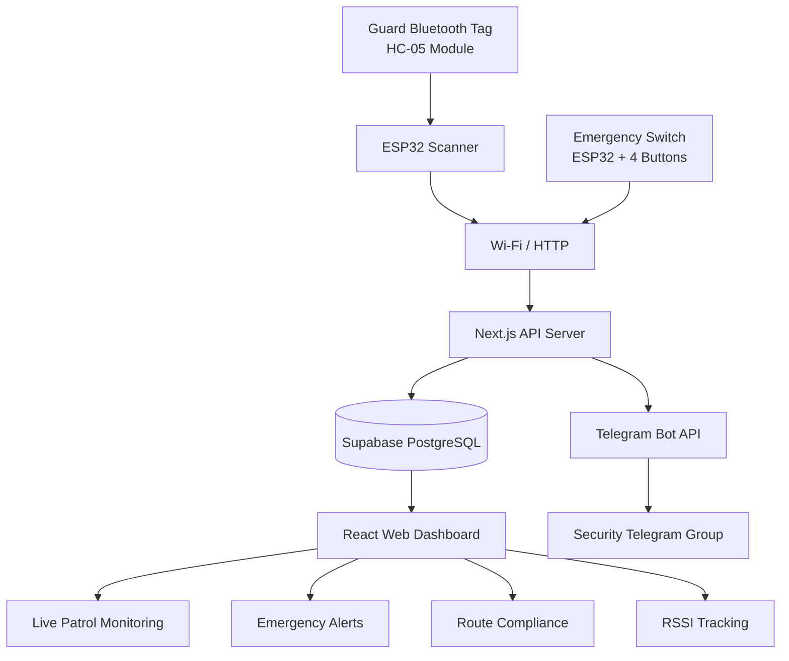

# 🛡️ SENTINEL
## Smart Security Patrol Monitoring System

<p align="center">
  <strong>An IoT-Based Bluetooth Security Patrol Monitoring and Emergency Alert System</strong>
</p>

<p align="center">
  
  
  
  
  
</p>

<p align="center">
  <a href="https://sentinel-patrol-dmk.vercel.app/">Live Website</a> •
  <a href="https://github.com/Manojkumar86390/sentinel-patrol">GitHub Repository</a>
</p>

---

## 📌 Overview

**Sentinel** is a smart security patrol monitoring system developed to automate security guard tracking, verify patrol activities, and provide instant emergency notifications using Bluetooth and Internet of Things (IoT) technology.

Traditional security patrol systems depend on manual logbooks and human supervision, which can lead to missed patrols, inaccurate records, and delayed emergency responses.

Sentinel addresses these challenges through a network of ESP32-based Bluetooth scanners, portable Bluetooth tags carried by security guards, dedicated emergency switch units, and a cloud-connected web dashboard.

The system automatically detects guards at designated checkpoints, records their patrol activities, monitors route compliance, and sends emergency notifications to administrators through Telegram and the web application.

The project was developed and field-evaluated at **Indian Institute of Information Technology, Design and Manufacturing, Kurnool (IIITDM Kurnool).**

## 🎯 Objectives

- Automate security guard patrol verification without requiring manual checkpoint interaction.
- Detect Bluetooth tags carried by security guards using ESP32 scanners.
- Maintain timestamped digital records of patrol activities.
- Monitor scheduled patrol routes and identify missed or delayed checkpoints.
- Provide a dedicated emergency alert mechanism.
- Notify security administrators through multiple communication channels.
- Provide a centralized dashboard for monitoring and managing security operations.
- Develop an affordable and scalable IoT-based security monitoring solution.

## ✨ Key Features

### 1. Bluetooth-Based Automatic Patrol Detection

- ESP32-based scanners continuously scan for nearby Bluetooth devices.
- HC-05 Bluetooth Classic modules act as portable guard identification tags.
- Device MAC addresses are used to identify registered Bluetooth tags.
- RSSI values are captured to understand signal strength and proximity.
- Patrol events are automatically recorded when a registered tag is detected.

### 2. Real-Time Patrol Monitoring Dashboard

- Centralized administrator dashboard.
- Live patrol activity monitoring.
- Guard and checkpoint information.
- Timestamped patrol history.
- Scanner status and device information.
- Downloadable patrol records in CSV format.

### 3. Patrol Route Compliance

Sentinel supports two patrol scheduling modes:

- **Looping Mode:** Guards follow a repeating sequence of checkpoints at configured intervals.
- **Fixed Time-Slot Mode:** Guards are expected to visit specified checkpoints during predefined time slots.

The system classifies checkpoint activities into:

- Completed
- Late
- Missed
- Upcoming

A configurable tolerance window is used for compliance calculations.

### 4. Emergency Alert System

The emergency switch contains four dedicated push buttons:

| Button | Emergency Type |
|---|---|
| 🔥 | Fire |
| ⚠️ | Accident |
| 🩸 | Bleeding |
| 🥊 | Fight |

When an emergency button is pressed:

1. The ESP32 detects the button press.
2. The emergency type, switch identification and location are transmitted to the server.
3. The alert is stored in the database.
4. The web dashboard displays the emergency notification.
5. Telegram sends a notification to the configured security group.
6. The dashboard provides audible text-to-speech announcements.

Administrators can acknowledge alerts while retaining their records in the alert history.

### 5. RSSI-Based Live Tracking

- Uses Bluetooth signal strength measurements from multiple scanners.
- Estimates the approximate position of a moving guard.
- Displays tracking information on an interactive campus map.
- Does not require GPS hardware on the guard's Bluetooth tag.

**Note:** This is an approximate positioning mechanism, not GPS-level location tracking.

### 6. Administrator Management

- Secure administrator login.
- Guard and Bluetooth tag registration.
- Scanner registration and checkpoint management.
- Emergency switch registration.
- Patrol route configuration.
- Emergency acknowledgement.
- CSV data exports.

---

## 🏗️ System Architecture

Sentinel follows a three-tier architecture consisting of the hardware layer, cloud processing layer, and presentation layer.



### Patrol Detection Workflow

```text
Guard carries Bluetooth Tag
          |
          v
ESP32 Scanner detects Bluetooth device
          |
          v
Capture MAC Address and RSSI
          |
          v
Connect to Wi-Fi
          |
          v
Send HTTP POST request
          |
          v
Next.js API processes patrol event
          |
          v
Store event in Supabase PostgreSQL
          |
          v
Update Web Dashboard
```

### Emergency Notification Workflow

```text
Emergency Button Pressed
          |
          v
ESP32 Emergency Switch
          |
          v
Send Emergency Data to API
          |
          v
Store Alert in Database
          |
          +----------------------+
          |                      |
          v                      v
    Web Dashboard           Telegram Bot
          |                      |
          v                      v
   Audible + Visual       Security Group
      Notification         Notification
```

---

## 🛠️ Technology Stack

### Hardware

| Component | Purpose |
|---|---|
| ESP32-WROOM-32 | Bluetooth scanner and emergency switch controller |
| HC-05 Bluetooth Module | Guard identification tag |
| Push Buttons | Emergency input |
| TP4056 Charging Module | Rechargeable tag battery charging |
| Lithium-Ion Battery | Portable tag power supply |
| USB Power Supply | Scanner and switch power |

### Software

| Technology | Purpose |
|---|---|
| Next.js 16 | Full-stack web application |
| React 19 | User interface |
| TypeScript 5.x | Type-safe application development |
| Tailwind CSS 4 | Responsive UI styling |
| Supabase | Cloud database and storage |
| PostgreSQL | Persistent data storage |
| Telegram Bot API | Emergency notifications |
| Leaflet.js | Interactive campus maps |
| Web Speech API | Browser-based voice announcements |
| Arduino IDE 2.x | ESP32 firmware development |
| Vercel | Application hosting |
| Git & GitHub | Version control |

---

## 🔌 Hardware Modules

### 1. ESP32 Scanner Unit

The scanner is installed at designated security checkpoints.

Its responsibilities include:

- Connecting to the campus Wi-Fi network.
- Performing active Bluetooth scans.
- Identifying registered guard tags.
- Capturing MAC addresses and RSSI values.
- Sending patrol information to the cloud API.
- Sending heartbeat events when no registered tag is detected.

### 2. Guard Bluetooth Tag

The guard carries a portable HC-05 Bluetooth Classic module.

Its responsibilities include:

- Providing a unique Bluetooth device identity.
- Remaining discoverable to nearby scanners.
- Enabling automatic checkpoint identification.
- Operating using a rechargeable battery.

### 3. Emergency Switch Unit

The emergency switch is an ESP32-based device containing four labelled push buttons.

| GPIO Pin | Emergency Type |
|---|---|
| GPIO 13 | Bleeding |
| GPIO 12 | Accident |
| GPIO 14 | Fire |
| GPIO 27 | Fight |

The firmware uses input pull-ups, button debouncing, and duplicate-alert cooldown logic.

---

## 📊 Experimental Results

The project was field-evaluated at IIITDM Kurnool.

### Deployment Locations

- Main Gate
- ECE Block
- Sports Area
- MVHR Hostel

### Performance Summary

| Parameter | Observed Result |
|---|---|
| Emergency to dashboard alert | Under 2 seconds |
| Emergency to Telegram notification | Under 4 seconds on average |
| Patrol verification cycle | 5–10 seconds |
| Complete hardware deployment cost | Approximately ₹1,200 |
| Registered campus checkpoints | 4 |

### Functional Testing

The following operations were tested:

- Bluetooth tag detection.
- Registered and unregistered tag identification.
- Scanner heartbeat reporting.
- Emergency button activation.
- Duplicate emergency prevention.
- Telegram notification delivery.
- Emergency acknowledgement.
- Patrol logging and dashboard updates.

The project report documents successful outcomes for the twelve functional test cases.

---

## 💻 Installation and Setup

### Prerequisites

Install the following tools before running the application:

- Node.js (compatible with the Next.js 16 project)
- npm
- Git
- Arduino IDE 2.x
- ESP32 board support package
- A Supabase account
- A Telegram account for bot configuration

### 1. Clone the Repository

```bash
git clone https://github.com/Manojkumar86390/sentinel-patrol.git
```

Navigate into the project directory:

```bash
cd sentinel-patrol
```

### 2. Install Dependencies

```bash
npm install
```

### 3. Configure Environment Variables

Create a `.env.local` file in the project root.

Configure the Supabase connection credentials and the application secrets using the exact variable names expected by the source code.

The report documents the following server-side configuration:

```env
ADMIN_USER=your_admin_username
ADMIN_PASS=your_secure_password

TELEGRAM_BOT_TOKEN=your_telegram_bot_token
TELEGRAM_GROUP_CHAT_ID=your_telegram_group_id

DEVICE_TOKEN=your_optional_device_secret
```

The `DEVICE_TOKEN` is an optional shared secret used to protect hardware-facing API endpoints.

Add the Supabase project URL and appropriate API key using the variable names defined in the project's Supabase client configuration.

**Important:** Never upload `.env.local`, database credentials, administrator passwords, or Telegram bot tokens to GitHub.

### 4. Run the Development Server

```bash
npm run dev
```

Open the following URL:

```text
http://localhost:3000
```

### 5. Build for Production

```bash
npm run build
```

Start the production server:

```bash
npm start
```

---

## ⚙️ ESP32 Firmware Setup

1. Install Arduino IDE 2.x.
2. Install the ESP32 board package.
3. Connect the ESP32 to your computer using USB.
4. Open the appropriate Scanner or Emergency Switch firmware.
5. Configure the Wi-Fi SSID and password.
6. Configure the application API endpoint.
7. Configure the scanner or switch identification.
8. Select the appropriate ESP32 board and COM port.
9. Compile and upload the firmware.

Ensure the ESP32 devices can access the deployed application over HTTPS.

---

## 🔗 API Overview

The application uses Next.js API routes to handle communication between the hardware, database, and dashboard.

| Method | Endpoint | Purpose |
|---|---|---|
| POST | `/api/patrol-events` | Receive patrol detection events |
| POST | `/api/emergency-alerts` | Receive emergency notifications |
| POST | `/api/login` | Administrator authentication |
| POST | `/api/logout` | End administrator session |
| POST | `/api/routes` | Create or update patrol routes |
| GET | `/api/compliance` | Retrieve patrol compliance |
| GET | `/api/attendance` | Retrieve attendance summaries |
| GET | `/api/dashboard-stats` | Retrieve dashboard statistics |

---

## ☁️ Deployment

The web application is deployed using Vercel, with Supabase providing managed PostgreSQL database services.

Live application:

**https://sentinel-patrol-dmk.vercel.app/**

Deployment workflow:

1. Push the project to GitHub.
2. Import the repository into Vercel.
3. Configure the required environment variables.
4. Connect the Supabase project.
5. Deploy the application.
6. Update the ESP32 firmware with the deployed API endpoint.

Vercel supports automatic deployments whenever changes are pushed to the configured production branch.

---

## 🔐 Security and Privacy

- Administrator authentication protects dashboard access.
- Session cookies are signed and expire after inactivity.
- Passwords are handled through server-side authentication configuration.
- Hardware endpoints can optionally validate a shared device token.
- Patrol and emergency events are maintained as historical records.
- Institutions should configure suitable access and data-retention policies because patrol records contain personal location information.

---

## 🚀 Future Enhancements

Potential improvements include:

- Native Android and iOS applications.
- CCTV integration.
- Advanced guard identification.
- Improved indoor positioning accuracy.
- Offline event buffering and synchronization.
- Automated testing and monitoring.
- Expanded multi-campus deployment.
- Advanced security analytics and reporting.

---

## ⚠️ Known Limitations

- Bluetooth RSSI measurements are affected by walls, interference, and environmental conditions.
- Approximate location estimation depends on the availability of multiple scanner readings.
- Hardware units require a stable Wi-Fi connection for cloud reporting.
- Events are not locally buffered during network outages in the documented implementation.
- The field evaluation used a limited hardware deployment and should not be interpreted as proof of large-scale production reliability.

---

## 👨‍💻 Project Contributors

Developed as an academic project under the Department of Electronics and Communication Engineering, IIITDM Kurnool.

| Contributor | Roll Number |
|---|---|
| D. Manoj Kumar | 12EC0020 |
| Mridul S Kumar | 12EC0006 |
| P. Sai Krishna | 123EC0016 |

**Project Guide:** Dr. Eswaramoorthy K V  
Assistant Professor, Department of Electronics and Communication Engineering.

**Institution:** Indian Institute of Information Technology, Design and Manufacturing, Kurnool.

**Year:** 2026

---

## 📜 License

This project is intended to be shared as an open-source academic and research initiative.

Add an appropriate `LICENSE` file to the repository before specifying a particular open-source license.

---

<p align="center">
  <strong>Sentinel – Making Security Patrols Smarter, Safer, and More Accountable.</strong>
</p>

<p align="center">
  Built with ❤️ using IoT, Bluetooth, ESP32, and Cloud Technologies.
</p>
